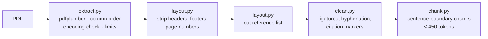
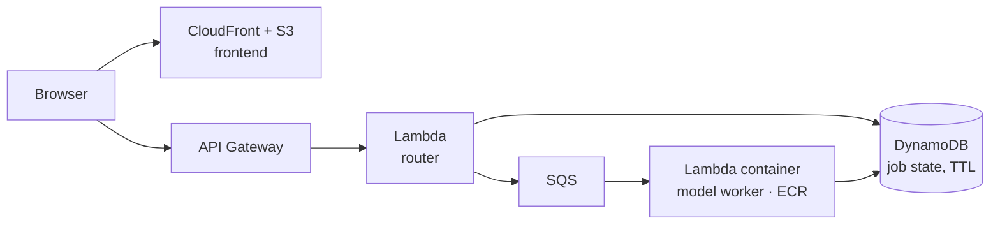

# turkish-pdf-summarizer

[](https://github.com/Ruchanbas/turkish-pdf-summarizer/actions/workflows/ci.yml)


**Turkish PDF summarization service: chunked inference, async job queue, AWS serverless.**

> **Status: Phase 1 of 6 is complete (the text pipeline).** It turns a Turkish PDF into clean, model-ready chunks and is fully tested. The summarization model, the async API and the AWS deployment are **not built yet**. See [Roadmap](#roadmap). This README describes only what exists in the code today.

This project rewrites an earlier Colab prototype from scratch. The prototype had three problems that no choice of model could fix:

- **Input truncation.** Text was cut at the model's 512-token window, so on a 30-page article only the first paragraph was summarized. Nothing warned the user about the rest.
- **Destructive cleaning.** Any parenthesis containing a number was removed, which deleted `(p < 0.05)`, `(n = 45)`, doses and years. Words like "Tablo" and "Şekil" were deleted outright.
- **Noise sent to the model.** Running headers, page numbers and the reference list went in as content.

Phase 1 fixes the input side. The rule it follows: **every sentence of the document reaches the model, inside the token budget, and nothing else does.**

## Phase 1: text pipeline



The order is deliberate. Header and footer detection needs page boundaries, so it runs before the pages are joined. Finding the reference heading needs line breaks, so it runs before the lines are unwrapped. Cleaning runs last because it deliberately destroys line structure. Every stage is measured on the same joined text, so the numbers can be compared.

Try it without any model (synthetic 7-page article from the test fixtures):

```text
$ python -m ozetle makale.pdf
Sayfa          : 7/7
Ham metin      :    8490 karakter
Süsleme sonrası:    7743  (-747)
Kaynakça sonra :    7253  (-490)
Temiz metin    :    7172
Parça          : 4  (bütçe 450 token)
uyarı: Gerçek tokenizer verilmedi; parça sınırları tahmini.
```

`--show-chunks` prints the chunks and `--json` prints machine-readable output.

### Guarantees (each one is a test)

| Guarantee | Enforced by |
|---|---|
| No chunk exceeds the token budget, under any input | `test_butce_asilmaz`, 25 randomized cases in `test_rastgele_metinlerde_garantiler` |
| No sentence is lost between chunks | `test_hicbir_cumle_kaybolmaz` |
| Findings survive cleaning: `(p < 0.05)`, `(n = 45)`, `Tablo 3`, years | `test_bulgular_silinmez`, `test_bulgular_modele_ulasir` |
| A long line is never treated as a header or footer | `test_uzun_satir_kenarda_bile_silinmez` |
| A reference cut that would remove most of the text is aborted | `test_guvenlik_freni` |
| Two-column pages are read left column first, then right | `test_okuma_sirasi_sol_sonra_sag` |
| Broken font encoding is reported as a warning and does not block the run | `test_bozuk_kodlama_uyarilir_ama_engellenmez` |

### Design decisions

- **Conservative cleaning.** Cleaning cannot be undone. A deleted word never reaches the summary, while leftover noise is usually ignored by the model. Only bracketed numeric citations such as `[3]` and `[4–7]` are removed. Author–year citations stay, because there is no safe way to tell `(Demir ve ark., 2019)` apart from `(n = 45)`.
- **The token budget is a hard limit.** Chunks are split at sentence boundaries with one sentence of overlap. If the overlap would push a chunk over budget, the overlap is dropped. If a single sentence is over budget, it is split at word boundaries. Turkish sentence splitting protects abbreviations (`Dr.`, `Prof.`, `vb.`, `ark.`, `Bkz.`), decimals (`3.14`), ordinals (`2. bölüm`) and initials (`M. Kemal`).
- **Headers and footers are found by edge band plus repetition.** A line is removed only if it sits in the band of short lines at a page edge **and** repeats on at least half the pages, or if it is a page number. Numbers are normalized, so `Sayfa 3` and `Sayfa 4` count as the same line. The same text in the middle of the page body is kept.
- **Column detection measures the gutter's width.** It looks for a wide empty strip near the middle of the page, not a thin line. Lines such as titles that cross the strip stay in place, and each two-column block is read left column first, then right.
- **Encoding guard.** Fonts that are not embedded produce `(cid:123)` artifacts, and Turkish letters are the first to break. `measure_garbling()` measures how much text is lost and tells the user why the output may be poor.
- **pdfplumber instead of PyMuPDF.** PyMuPDF is faster, but it is AGPL-licensed, and this project is meant to be deployed as a service.

### Bugs the tests caught

Each bug below was found while writing this code and now has a regression test:

| Bug | What went wrong | Guarded by |
|---|---|---|
| Fixtures weren't testing Turkish | reportlab's built-in Helvetica can't encode `ı ş ğ İ`, so "yapılmıştır" went into the PDF already broken and the tests still passed. The fixtures now embed DejaVu Sans, and the same discovery led to the encoding guard. | `test_helvetica_turkce_tasiyamaz` |
| Overlap broke the budget | The overlap sentence was carried into the next chunk without re-checking the budget, so a chunk was over the limit as soon as it was created. | `test_ortusme_butceyi_delemez` |
| The tail merge only worked by cheating | Merging a small last chunk into the previous one only succeeded because of a 15% tolerance, which meant exceeding the budget. With a hard budget the step can never succeed under greedy packing, so it was deleted. | `test_son_parca_butceyi_asmaz` |
| Short pages got wiped | A fixed "first/last 3 lines" window covered the whole of a short title page. | `test_kisa_sayfa_tamamen_silinmez` |
| A false column gutter | On pages of similar lines, word gaps lined up vertically and the detector split every line down the middle. | `test_tek_sutunda_yanlis_pozitif_yok` |
| Metrics added characters | One stage was counted before the pages were joined and the next after, so cutting the references appeared to *add* text. | `test_metrikler_monoton_azalir` |
| Linting Turkish as an attack | ruff's homoglyph rule raised 1,000+ false positives on `ı`. Only the Turkish alphabet was whitelisted, and the rule stayed on. It then caught real invisible characters (NBSP, en dash) in the source, which are now written as `\u` escapes. | `pyproject.toml` |

## Run locally

```bash
git clone https://github.com/Ruchanbas/turkish-pdf-summarizer
cd turkish-pdf-summarizer
python -m venv .venv && source .venv/bin/activate
pip install -e ".[dev]"

pytest --cov                 # 181 tests (incl. doctests), ~98% branch coverage
ruff check . && mypy         # lint + strict type check
python -m ozetle article.pdf --show-chunks
```

From Python:

```python
from ozetle.pipeline import prepare

doc = prepare("article.pdf", max_tokens=450)
for chunk in doc.chunks:
    print(chunk.index, chunk.token_count, chunk.text[:80])
print(doc.metrics.as_dict(), doc.warnings)
```

## Project layout

```
src/ozetle/
├── pdf/
│   ├── extract.py    PDF → pages: limits, column order, encoding check, typed errors
│   └── layout.py     header/footer/page-number removal, reference cut
├── text/
│   ├── clean.py      Unicode, hyphenation, citation markers, unwrapping
│   └── chunk.py      Turkish sentence splitting, budgeted chunking
├── pipeline.py       single entry point + per-stage metrics
└── __main__.py       CLI
tests/                pytest; PDFs are generated per test with an embedded Turkish-capable font
```

## Roadmap

- [x] **Phase 1: text pipeline.** Extraction, layout cleanup, cleaning, chunking, limits, CLI.
- [ ] **Phase 1 (rest): model loader and keywords.** Lazy, thread-safe model loading and KeyBERT keywords with MMR.
- [ ] **Phase 2: model benchmark.** The current bert2bert baseline against mT5 (small/base) and TURNA on MLSUM-TR, scored with ROUGE-1/2/L, BERTScore and CPU latency.
- [ ] **Phase 3: async API.** FastAPI `POST /summarize` returns a `job_id` and `GET /jobs/{id}` returns status and result. Repeat uploads are de-duplicated by SHA-256, with structured logging.
- [ ] **Phase 4: frontend.** Drag-and-drop upload, live job progress, and the summary shown side by side with the source.
- [ ] **Phase 5: AWS and CI/CD.** Terraform-managed infrastructure, deployed from GitHub Actions through OIDC with no long-lived keys.
- [ ] **Phase 6: live demo and docs.**

Planned deployment (Phase 5, not built yet):



The job runs on a queue because summarizing a long PDF on CPU takes longer than API Gateway's 29-second request limit.

## Known limitations

- **No OCR.** A scanned PDF is rejected with a clear error (`EmptyPdfError`) instead of producing an empty summary.
- **Approximate token counts.** Until a real tokenizer is plugged in (Phase 2), tokens are estimated at 1.6 per word on purpose, so chunks run small rather than overflowing. The pipeline warns about this.
- **The reference cut removes everything after the heading**, including any appendices that follow it.
- **Column detection handles at most two columns** and relies on heuristics.
- **Standalone numbers from 1900 to 2099 are treated as years, not page numbers.** On a continuously paginated journal, those page numbers are only caught by the repetition rule.

## License

MIT, see [LICENSE](LICENSE). The test fixture font (DejaVu Sans) is redistributed under its own license: [tests/fixtures/fonts/LICENSE](tests/fixtures/fonts/LICENSE).
