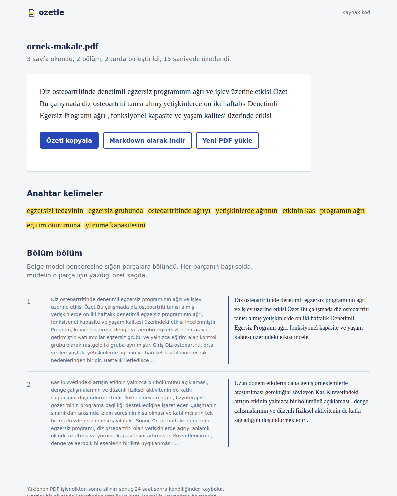
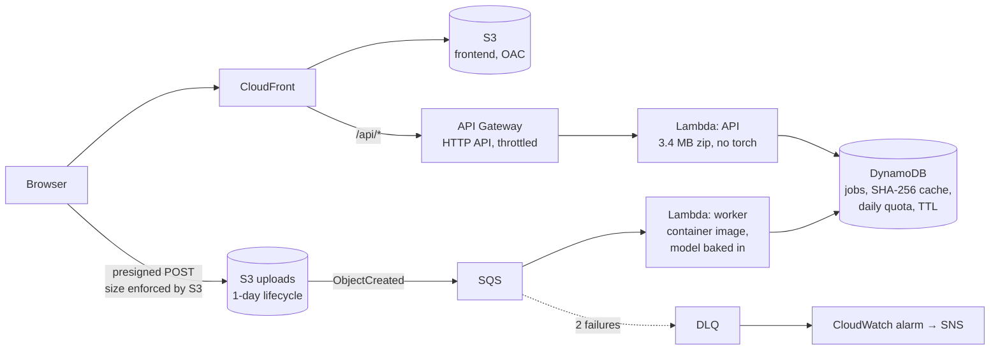
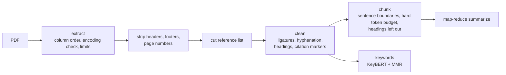

# turkish-pdf-summarizer

[](https://github.com/Ruchanbas/turkish-pdf-summarizer/actions/workflows/ci.yml)
[](https://github.com/Ruchanbas/turkish-pdf-summarizer/actions/workflows/models.yml)


**Turkish PDF summarization service: chunked inference, an async job queue, AWS serverless.**

Upload a Turkish academic PDF and get back a summary, keywords, and a section-by-section view that puts each part of the source next to the model's note on it. The model is chosen by a benchmark, not by guesswork. The whole stack (API, worker, frontend, infrastructure) runs locally with one command and deploys to AWS from GitHub Actions without a single long-lived key.



<sub>Real output from mT5-small on [`docs/ornek-makale.pdf`](docs/ornek-makale.pdf), a fictional article written for this repo. The screenshot is produced by [`screenshot.yml`](.github/workflows/screenshot.yml) in a real browser against the real model.</sub>

## Contents

- [Architecture](#architecture)
- [Choosing the model: benchmark](#choosing-the-model-benchmark)
- [Bugs the tests and the benchmark caught](#bugs-the-tests-and-the-benchmark-caught)
- [Run it](#run-it)
- [Deploy to AWS](#deploy-to-aws)
- [Quality gates](#quality-gates)
- [Known limitations](#known-limitations)

## Architecture



**Why asynchronous.** Summarizing a long PDF on CPU can take longer than API Gateway's 29-second request limit. The API opens a job record and returns at once. The browser uploads straight to S3, the S3 event goes through SQS to the worker, and the browser polls the job.

**Why two Lambdas.** The API is a 3.4 MB zip with no torch and no pdfplumber; CI checks this by importing it in a clean interpreter. The worker is a container image with the model weights inside. User-facing requests never wait on a cold model load.

**Why presigned POST, not PUT.** The `content-length-range` condition lets S3 itself reject oversized files, so the API never touches the bytes.

**The same code runs locally.** The local backend swaps DynamoDB for an in-memory store, S3 for a folder, and SQS for a worker thread. The frontend makes the same calls in both setups.

### Text pipeline



The stage order matters:

1. Header and footer detection needs page boundaries, so it runs before pages are joined.
2. Finding the reference heading needs line breaks, so it runs before lines are unwrapped.
3. Cleaning runs last, because it deliberately destroys line structure.

Long documents use map-reduce. Each chunk is summarized first. If the joined partial summaries fit the model window, they are summarized once more. If not, they are re-chunked and the step repeats.

## Choosing the model: benchmark

Each candidate runs through **the production code path**: the same chunker, the same map-reduce, the same generation settings. The table therefore measures what the service would actually deliver, not a model card. [`bench/run.py`](bench/run.py) runs as a parallel GitHub Actions matrix ([`bench.yml`](.github/workflows/bench.yml)).

MLSUM-TR test set, 100 articles (seed 42), CPU on a GitHub-hosted runner:

| Model | Params | ROUGE-1 | ROUGE-2 | ROUGE-L | BERTScore F1 | p50 / article | p95 / article | Load |
|---|---:|---:|---:|---:|---:|---:|---:|---:|
| [TURNA](https://huggingface.co/boun-tabi-LMG/turna_summarization_mlsum) | 1142M | **40.49** | **27.75** | **37.04** | **68.44** | 7.5 s | 31.9 s | 48.6 s |
| [mT5-small](https://huggingface.co/ozcangundes/mt5-small-turkish-summarization) | 300M | 39.12 | 27.08 | 35.29 | 67.04 | 3.5 s | 10.6 s | 23.8 s |
| [mT5-base](https://huggingface.co/mukayese/mt5-base-turkish-summarization) | 582M | 37.98 | 25.10 | 34.32 | 67.05 | 8.2 s | 23.6 s | 32.2 s |
| [BERT2BERT](https://huggingface.co/mrm8488/bert2bert_shared-turkish-summarization) ¹ | 140M | 38.56 | 25.65 | 35.22 | 68.38 | **2.2 s** | **8.2 s** | 8.6 s |
| lead-3 (first three sentences) | – | 33.09 | 20.88 | 27.23 | 63.95 | 0 | 0 | – |

<sub>¹ Only loads correctly with the shared-weights fix described [below](#bugs-the-tests-and-the-benchmark-caught). Without it, transformers 5 leaves 198 decoder layers randomly initialized.</sub>

**Decision: mT5-small.**
- **TURNA is the most accurate but does not fit.** Its weights alone are about 4.6 GB in fp32, beyond the 3008 MB Lambda memory limit on some new AWS accounts. It is also licensed for non-commercial research only. mT5-small reaches 95% of its ROUGE-L at a quarter of the size and half the median latency.
- **BERT2BERT is a genuine contender.** It ties mT5-small on ROUGE-L, scores higher on BERTScore, and is faster, with half the parameters. It loses on robustness rather than quality: the model card states no license, it loads correctly under transformers 5 only through this repo's re-tying fix, its BERT window is fixed at 512 tokens (mT5 takes 768, so fewer chunks), and its ROUGE-2 is 1.4 points lower. If those risks were acceptable, it would be the faster choice; switching is a one-variable change (`OZETLE_MODEL=bert2bert`).
- **Bigger was not better.** mT5-base scored *below* mT5-small on this path.

Every model clears the lead-3 baseline by a wide margin. That baseline is the sanity check: a model that cannot beat "copy the first three sentences" is not worth running.

**Notes on the numbers**

- **ROUGE needs a Turkish tokenizer.** `rouge-score`'s default tokenizer keeps only `[a-z0-9]`. It turns "Çalışmasında İSTANBUL ve Işık" into `al mas nda i stanbul ve i k`: Turkish letters disappear and fragments start matching each other. The benchmark tokenizes with Unicode word boundaries and Turkish lowercasing. The default tokenizer inflates ROUGE-1 by 4.5 to 5 points for every model (lead-3: 38.08 vs 33.09; mT5-small: 44.15 vs 39.12), so scores computed with it are not comparable to these.
- **Model cards are not comparable either.** mT5-base's card reports ROUGE-1 47.4. That number comes from the training run's own evaluation, not from this pipeline; the default tokenizer alone would account for about 4.6 points of the gap.
- **The TURNA input prefix was measured, not guessed.** TURNA has no model card, so `bench/run.py prefix` compared `""`, `"[S2S] "` and `"[S2S]"` on the same 8 articles. ROUGE-L came out at 25.87, 24.98 and 25.89, which is noise; the simplest option was kept.
- **Abstractive models invent details.** In the prefix test, TURNA placed an incident from Pamukkale in "Merkezefendi" and then "Serik", two districts the article never mentions. This is why the interface tells readers to check the source before quoting.

## Bugs the tests and the benchmark caught

Each bug below has a regression test.

| What went wrong | Guarded by |
|---|---|
| **transformers 5 silently breaks shared encoder-decoder checkpoints.** When the benchmark first loaded the original bert2bert model, the strict loader reported 198 decoder weights missing. The checkpoint was trained with `tie_encoder_decoder=True`. transformers 4 tied those weights on load; transformers 5 initializes them randomly and only prints a warning, so the model loads without error and produces fluent nonsense. This is the same failure mode that `strict=False` hid in the prototype. The fix does not loosen the check. The loader re-ties every shared layer to the encoder parameter itself, and then accepts a "missing" weight only if it **shares memory** with a loaded one. | `test_paylasimli_kayit_bagli_yuklenir`, `test_paylasimli_kayitta_gercek_eksik_yakalanir` |
| **Missing weights loaded silently.** The prototype loaded with `strict=False`, so randomly initialized layers produced fluent Turkish that meant nothing. A missing weight is now an error, and the Docker build runs the same check, so a broken model cannot ship. | `test_eksik_agirlik_yakalanir` (real transformers, tiny model) |
| **The fixtures weren't testing Turkish.** reportlab's Helvetica cannot encode `ı ş ğ İ`, so "yapılmıştır" went into the test PDFs already broken and the tests still passed. The fixtures now embed DejaVu Sans. The same discovery led to the encoding guard for user PDFs with non-embedded fonts. | `test_helvetica_turkce_tasiyamaz` |
| **A false column gutter.** On pages of similar lines, word gaps lined up vertically and the column detector split every line down the middle. Gutters must now be wider than a word gap. | `test_tek_sutunda_yanlis_pozitif_yok` |
| **Overlap broke the token budget.** The overlap sentence carried into the next chunk was never re-checked against the budget. | `test_ortusme_butceyi_delemez` |
| **The tail merge only worked by cheating.** Merging a small last chunk into the previous one only ever succeeded through a 15% tolerance, i.e. by exceeding the budget. Under greedy packing and a hard budget it can never succeed, so it was deleted. | `test_son_parca_butceyi_asmaz` |
| **Headings glued to sentences, then copied into the summary.** Unpunctuated headings ran into the following text ("…etkisi Özet Bu çalışmada…") and broke sentence splitting. Worse, the news-trained model copied the title into the summary, because a news article's first line is its lead. Headings are now paragraphs of their own and stay out of the model input; keyword extraction still sees them, since a title is the best keyword source. | `TestHeadings`, `test_baslik_ozetleyiciye_gitmez_anahtar_kelimeye_gider` |
| **Keyword junk.** `stop_words="turkish"` does not exist in scikit-learn, and `str.lower()` turns `İ` into `i̇`. The real model then showed more: abbreviations and verbs ("ölçüldü dr"), n-grams across removed words ("sonuçları ortalama", which appears nowhere in the text), and pairs across phrase boundaries ("etkinin kas", "osteoartritinde ağrıyı"). Pairs now form only from truly adjacent words, never with a case-marked word. Vowel harmony keeps "fiziksel aktivite" intact: after a vowel the locative is always -da/-de, so "aktivite" is not mistaken for one. | `TestCandidatePhrases`, `TestPairFilter` |
| **Metrics added characters.** One stage was measured before pages were joined and the next one after, so cutting the references appeared to *add* text. | `test_metrikler_monoton_azalir` |
| **A year read as a page number.** "2024" on a title page was deleted as a page number. | `test_kisa_sayfa_tamamen_silinmez` |
| **Lint treated Turkish as an attack.** ruff's homoglyph rule raised 1,000+ false positives on `ı`. Only the Turkish alphabet is whitelisted, and the rule then caught real invisible characters (NBSP, en dash) in the source. | `pyproject.toml` |

## Run it

**Docker** (API, worker and frontend in one container):

```bash
docker compose up                      # http://localhost:8000
OZETLE_MODEL=lead docker compose up    # instant, no model download (lead-3 baseline)
```

**Python:**

```bash
pip install torch --index-url https://download.pytorch.org/whl/cpu
pip install -e ".[api,models]"
python -m ozetle.service               # http://127.0.0.1:8000, API docs at /api/docs
python -m ozetle docs/ornek-makale.pdf --show-chunks   # pipeline only, no model
```

**API:**

| Endpoint | |
|---|---|
| `POST /api/jobs` `{filename, size, sha256?}` | `201` with a job and an upload target (`url`, `fields`). If the same PDF (by SHA-256) was summarized in the last 7 days, the job comes back `done` with no upload. Returns `413`/`415` on limits and `429` past the daily quota. |
| `POST <upload.url>` | Multipart upload of the file. Goes straight to S3 on AWS, to the API locally. |
| `GET /api/jobs/{id}` | `awaiting_upload` → `queued` → `processing` → `done` / `failed`, with the result when done. |
| `GET /api/health` | Version, backend, model, limits. |

All settings are `OZETLE_*` environment variables ([`service/config.py`](src/ozetle/service/config.py)): model, limits (20 MB, 60 pages, daily quota), TTLs, and backend.

## Deploy to AWS

You need an AWS account and Terraform ≥ 1.10. Two one-time steps, then every push to `main` deploys.

**1. Bootstrap, once, with admin credentials:**

```bash
aws iam list-open-id-connect-providers   # does a GitHub provider already exist?
cd infra/bootstrap
terraform init
terraform apply                           # add -var create_oidc_provider=true if it doesn't
```

This creates the state bucket and a deploy role. The role can only be assumed from this repo's `main` branch and is limited to `ozetle-*` resources.

**2. Set repository variables.** Go to Settings → Secrets and variables → Actions → Variables:

| Variable | Value |
|---|---|
| `AWS_ROLE_ARN` | bootstrap output `deploy_role_arn` |
| `TF_STATE_BUCKET` | bootstrap output `state_bucket` |
| `ALERT_EMAIL` | optional: alarm and budget emails |
| `OZETLE_MODEL` | optional: catalog key baked into the worker image (default `mt5-small`) |
| `WORKER_MEMORY_MB` | optional: worker memory (default 3008; raise it for larger models if your account allows) |

Then run the **Deploy** workflow (or push to `main`). It builds the worker image with the model inside, applies Terraform, uploads the frontend and finishes with a health check. The summary prints the URL. Without `AWS_ROLE_ARN` the deploy job skips, so forks stay green.

**Cost.** Everything bills per use, so an idle deployment costs close to nothing. The one standing cost is ECR storage for the image, a few GB at cents per month. Guards: a daily job quota, API throttling, at most 2 concurrent workers, and an optional $5/month budget alert. To remove everything, run `terraform destroy` in `infra/`, then in `infra/bootstrap/`.

**Monitoring.** Alarms fire when a job lands in the DLQ (the user would otherwise see "processing" forever), on worker errors, and on API 5xx responses. Logs are JSON, so CloudWatch Logs Insights can query fields like `job_id`, `seconds` and `chunks` directly.

## Quality gates

352 tests (including doctests), 97% branch coverage, `ruff` clean, `mypy --strict` clean. CI runs these jobs on every pull request:

| Job | What it proves |
|---|---|
| Lint & type check | ruff, ruff format, mypy strict |
| Tests (3.11, 3.12, 3.13) | pipeline, service (AWS mocked with moto), API |
| Model code | real transformers against a tiny model trained inside the test, no network |
| Frontend end-to-end | Playwright in a real browser against the real API |
| Terraform | `fmt` and `validate` for both stacks |
| Packaging | the API zip imports in a clean interpreter, both images build, the local image serves the UI |

[`models.yml`](.github/workflows/models.yml) also downloads the real model weekly and on model-code changes, so a model removed from Hugging Face or a breaking transformers release is caught before users see it. The shared-weights regression above shows why this job exists.

## Known limitations

- **No OCR.** A scanned PDF is rejected with a clear message (`EmptyPdfError`) instead of returning an empty summary.
- **News-trained models.** The candidates were fine-tuned on MLSUM news, not academic papers. Quality on academic text has not been benchmarked.
- **Abstractive models can invent facts** (see the benchmark notes). The UI says so.
- **The reference cut removes everything after the heading,** including appendices.
- **Column detection handles at most two columns** and is heuristic.
- **The local backend keeps jobs in memory,** so they are lost on restart. It is meant for development and demos.

## Project layout

```
src/ozetle/
├── pdf/        extract.py (pdfplumber, columns, encoding check) · layout.py (headers, references)
├── text/       clean.py · chunk.py (Turkish sentence splitting, budgeted chunks)
├── models/     loader.py (lazy, strict, tie-aware) · summarizer.py (catalog, map-reduce)
│               keywords.py (KeyBERT + MMR) · download.py (bake + verify at image build)
├── service/    api.py · jobs.py (memory/DynamoDB) · storage.py (folder/S3) · processing.py
│               lambda_api.py · lambda_worker.py · local.py · logs.py (JSON)
└── pipeline.py PDF → model-ready chunks + per-stage metrics
frontend/       no build step, no dependencies
infra/          Terraform: bootstrap/ (state, OIDC, deploy role) and the app stack
bench/          model benchmark
tests/          unit, service (moto), tiny-model, e2e (Playwright)
```

## License

MIT, see [LICENSE](LICENSE). Model licenses are their own: mT5-small is MIT, mT5-base is Apache-2.0, and TURNA is non-commercial research only. The test font (DejaVu Sans) ships under [its own license](tests/fixtures/fonts/LICENSE).
